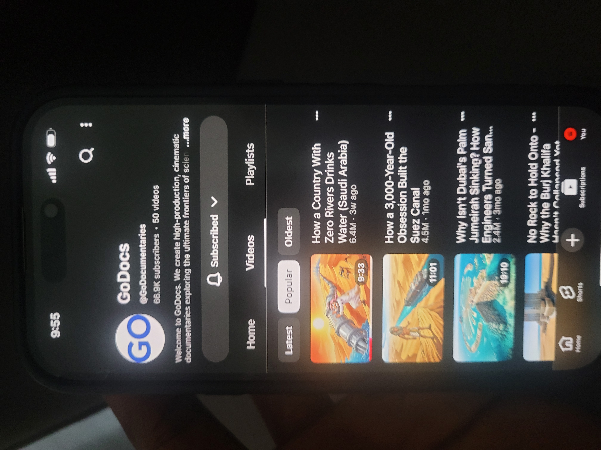

# GoDocs (@GoDocumentaries): Style Analysis

**Status:** Popular-tab screenshot, 9 frames from inside the Saudi water video (`frames/`), and a third-party analytics page.

## Channel snapshot (November 2026)
| Item | Value |
|---|---|
| Subscribers | 66.9K (OutlierKit listed about 40.3K earlier, so it's growing fast) |
| Videos | 50 |
| Positioning | "High-production, cinematic documentaries exploring the ultimate frontiers of science…" |
| Niche | Engineering, geography and megaprojects ("how does X work / why hasn't X failed") |

| Popular video | Views | Age | Length |
|---|---|---|---|
| How a Country With Zero Rivers Drinks Water (Saudi Arabia) | **6.4M** | 3 weeks | 9:33 |
| How a 3,000-Year-Old Obsession Built the Suez Canal | **4.5M** | 1 month | 11:01 |
| Why Isn't Dubai's Palm Jumeirah Sinking? How Engineers Turned San… | **2.4M** | 3 months | 19:10 |
| No Rock to Hold Onto – Why the Burj Khalifa Hasn't Collapsed Yet | n/a | n/a | n/a |

**The key number:** 6.4M views on a channel with 67K subscribers, so about **95 views for every subscriber**. The algorithm is pushing these videos to people who have never heard of the channel. That only happens when the **title and thumbnail get very high click rates from a broad audience**.

## The visual style (from the thumbnails)
1. **Painterly 2D cartoon illustration**, not stick figures: storybook or editorial-cartoon style with textured shading and cinematic lighting.
2. **Exaggerated, expressive characters** that represent a place (a man in a thobe straining to pull a giant pipe, an ancient Egyptian figure beside a container ship).
3. **One giant object** carries the idea: a pipe, a canal, an island, a tower. **Scale and struggle** are shown in one picture.
4. **Warm, saturated colours** (desert orange, sun yellow, turquoise sea) against high-contrast blue water. They look bright and inviting in a feed.
5. **Aerial or diagonal camera angles** that look epic and give a clear sense of geography.
6. **No text on the thumbnails**: the image alone tells the story.
7. Very likely **AI-generated illustrations**, animated with camera moves and some motion.

## What their titles do (the same rules we already use)
- **Paradox:** "a country with **zero rivers** drinks water", "why **isn't** it sinking", "why **hasn't** it collapsed **yet**".
- **Time and scale contrast:** "a **3,000-year-old** obsession built the Suez Canal".
- **A country in brackets**: "(Saudi Arabia)" pulls in viewers who care about that country.

## Verdict for Rise & Ruin: a good fit, with changes
**Why it works for us**
- It stands out from economics channels, which mostly use stock footage, maps and charts. Illustrated scenes are more emotional and more memorable.
- It's ideal for SCALE and SYMBOL shots (a leader dragging a chain of debt, a country map cracking under a mountain of cash).
- AI image tools (Flow) produce this illustrated style **more reliably and attractively than stick figures**.
- It's proven to break out: millions of views on a small channel.

**What to change**
1. **Tone:** their colours are warm and full of wonder, while our topics are crises. Keep the painterly style but use the Rise & Ruin palette: dusk and storm lighting, navy shadows, **danger red** for the country in crisis, yellow highlights.
2. **Signature motif:** keep the **red bar over the eyes** on every leader or official. Never draw a realistic likeness of a real politician.
3. **Respectful cultural depiction:** traditional clothing is fine when it's accurate and neutral. Never use mocking stereotypes.
4. **A data layer they don't have:** real maps and simple charts in our brand style between the illustrated scenes, so the economics stays credible.
5. **Our own look, not theirs:** our own palette, the red-bar motif, map and chart plates, and our title and thumbnail system. Don't copy their compositions or characters.
6. **Thumbnails:** test their no-text illustrated style against our 1–4 word text style using Test & Compare.

**What happens to the stickman cast:** use it for Shorts, explainer diagrams and simple chart scenes, or retire it. The main video style becomes illustrated.

## Frame study (9 frames from "How a Country With Zero Rivers Drinks Water")
| Frame | Shot type | What it does |
|---|---|---|
| 01 Dry tap and empty glass, oil pumps behind | SYMBOL | The whole paradox (oil rich, water poor) in one image. Blurred background, warm sand palette |
| 02 Man in thobe with binoculars | CHARACTER | Clean adult-cartoon style, flat cel shading, outlines; a "searching for water" beat |
| 03 Exhausted man with an empty glass (a leaf falls from the tap) while another celebrates in a money rain | CONTRAST | Foreground vs background tells an inequality story, with humour. **The most useful shot for our niche** |
| 04 Ancient ruins in the desert | ESTABLISHING | Painterly, semi-realistic history shot |
| 05 Skyscraper city in the dunes | ESTABLISHING | Aerial, semi-realistic: modern wealth |
| 06 Storm clouds | MOOD PLATE | Transition and tension; no characters, cheap and reusable |
| 07 Cracked ground cross-section | CROSS-SECTION | Explains a hidden mechanism like a diagram |
| 08 Underground cave lake | CROSS-SECTION or ENVIRONMENT | Dark blue, mysterious: the hidden resource |
| 09 Water bursting from a drilling rig | HERO MOMENT (likely an AI video clip) | Semi-photoreal action shot |

**Takeaways**
- **Mostly still illustrations** animated with pans and zooms, plus a few action clips (frame 09), which matches our Flow VIDEO/IMAGE/REUSE budget.
- **Many frames have no characters** (04–08). Environments carry the story, and characters appear for emotional beats.
- **The style isn't fully consistent**: cartoon line art (01, 02, 03, 06, 07, 08) mixed with semi-realistic renders (04, 05, 09). We can beat this by locking one style.
- **No text on screen**: the visual metaphors do the explaining. We add a data layer with real maps and charts and overlay numbers.

## Decision
Rise & Ruin adopts the illustrated style as its main video look, with the RISE/RUIN colour system and the red-eye-bar leader. See `../../channel/STYLE-GUIDE.md` and `../../MASTER-IMAGE-PROMPT-V2.md`. The stickman cast stays for Shorts and simple diagrams.
