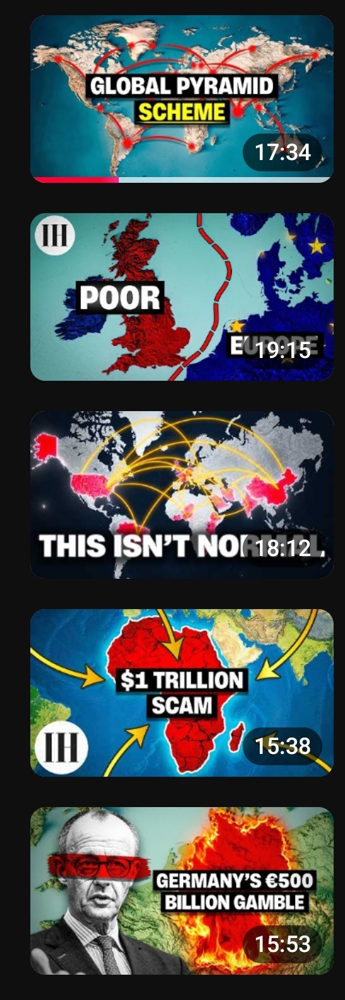

# Thumbnail Analysis: The Invisible Hand (top 5 popular)

| # | Thumbnail text | Visual | Accent |
|---|---|---|---|
| 1 | GLOBAL PYRAMID **SCHEME** | 3D relief world map, red arcs and glowing nodes | Red lines, yellow word |
| 2 | POOR / EUROPE | The UK in red and Europe in blue (EU stars), a red dashed border splitting them | Red vs blue |
| 3 | THIS ISN'T NORMAL | Dark world map, the US and China glowing red, yellow trade arcs | Red glow, yellow arcs |
| 4 | $1 TRILLION SCAM | Africa in red with cracks, yellow arrows pointing in from every side | Red land, yellow arrows |
| 5 | GERMANY'S €500 BILLION GAMBLE | A black-and-white politician photo with a red bar over the eyes, and Germany on fire | Red and orange fire |

## 5 things that get the clicks

1. **The map is the main image.** In 4 of 5 there is no face, just a 3D relief map. A map says "geography and economy" in 0.1 seconds and looks premium.
2. **Red marks the country in danger, against calm blue and teal.** Red goes only on the subject (UK, Africa, Germany, US/China, the network). Everything else is cool-toned, so the eye goes straight to the problem.
3. **1–4 words containing an accusation or a money figure.** SCHEME, POOR, SCAM, GAMBLE, ISN'T NORMAL, $1 TRILLION, €500 BILLION. White heavy sans-serif on black boxes, with one word in yellow. Each one is a verdict, not a topic.
4. **Graphics that tell a story without words.** Arrows pointing into Africa (who is taking from it?), arcs connecting countries (a hidden network), a dashed border (a divide), fire (destruction). Movement and conflict are visible at a glance.
5. **The thumbnail and the title are two halves of one story.** The title asks or explains ("If Every Country is in Debt, Who's the Money Owed To?"). The thumbnail gives a shocking answer ("GLOBAL PYRAMID SCHEME"). They never repeat each other, and a gap like that makes people click.

**Also:** the IH logo in a corner (3 of 5) and the same style everywhere means returning viewers recognise the channel instantly.

## Their mistake: text hidden behind the timestamp

On mobile, the video length badge covers the bottom-right corner. "EUROPE" (19:15) and "NORMAL" (18:12) are partly hidden.
**Rule:** keep text and key visuals out of the bottom-right 25% × 20% of the thumbnail. Put the logo top-left or bottom-left.

## Stickman thumbnail system for our channel

| Element | Rule |
|---|---|
| Canvas | 1280×720. Design for a phone: check it at 25% zoom |
| Background | A 3D relief map (teal or blue sea) or a dark world map. One country highlighted in **red** |
| Story graphic | One element only: arrows, cracks, fire, a dashed border, a falling chart line or network arcs |
| Character (optional) | **A stickman caricature of the leader or a citizen** in a strong pose (head in hands, holding an empty wallet, standing on a crumbling map). No realistic images of real people |
| Text | 1–4 words: a verdict word (BROKE, SCAM, TRAP, GAMBLE, COLLAPSE, NEXT?) or a money figure ($80 BILLION). White on black boxes, with one word in yellow |
| Safe zones | Nothing important in the bottom-right corner. Logo top-left |
| Colour budget | Cool background, red for danger, yellow for one highlight. Nothing else |
| Title link | The thumbnail gives the verdict and the title asks or explains. Never the same words |

### Examples
- **How Sri Lanka Went Bankrupt in 3 Years:** Sri Lanka in red with cracks, a stickman citizen holding an empty wallet. "BANKRUPT" in yellow.
- **Why Egypt Can't Escape Its Debt Trap:** Egypt in red inside a giant bear trap or chain. "DEBT TRAP".
- **Why China's Property Crash Is Bigger Than 2008:** China in red, falling stickman towers. "WORSE THAN **2008**".
- **What Happens When a Country Runs Out of Dollars?:** a dark map, one red country, yellow arrows of dollars flowing out. "$0 LEFT".

### Process for each video
1. Write the title, then 3 thumbnail text options. Pick the strongest verdict.
2. Make 2–3 versions (for example a map-only one and one with a stickman).
3. Upload with YouTube **Test & Compare**.
4. After 72 hours, if fewer than 4% of people who see it click, change the thumbnail.
