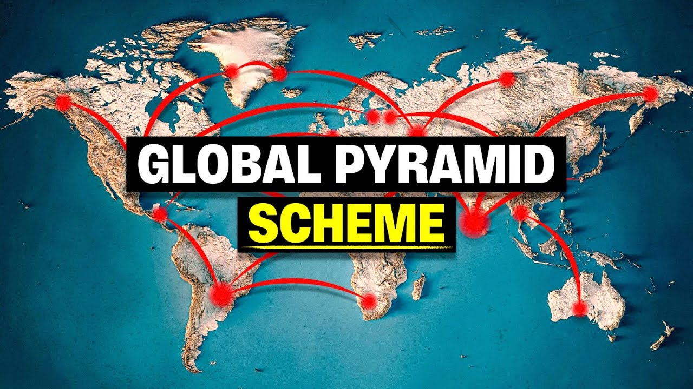

# Breakdown: "If Every Country is in Debt, Who's the Money Owed To?"

**Channel:** The Invisible Hand (@TheInvisibleHandCo)
**Status:** The channel's most popular video
**Length:** about 17:30 (about 14:00 of content and about 3:30 of sponsor read)
**Script length:** about 2,700 words, read at about 155 words per minute
**Thumbnail:** `thumbnail.jpg` in this folder

---

## 1. Title analysis

> If Every Country is in Debt, Who's the Money Owed To?

| What it does | Why it works |
|---|---|
| **Paradox format: "If X, then who/why Y?"** | It takes a fact everyone accepts (every country is in debt) and turns it into a logical puzzle. The brain wants to close the gap. |
| **A question people have privately wondered about** | Most people have had this thought and never looked it up. The video "answers your own question." |
| **No names, dates or news** | Evergreen. It gets searched and recommended for years, which is why it's the top video. |
| **Universal scope ("every country")** | It's relevant to viewers in every country, which means a bigger potential audience. |
| **Simple words, about 10 of them** | A 12-year-old understands the question, even though the answer is complex. |

**Reusable template:** `If [universal fact], [who/where/why] [obvious-but-unanswered question]?`

- If Money Is Printed, Why Can't Everyone Be Rich?
- If Banks Lend Out Your Deposit, Where Is Your Money Right Now?
- If Everyone Is in Debt, Who Is Actually Rich?

---

## 2. Thumbnail analysis

| Element | Choice | Effect |
|---|---|---|
| Background | 3D relief world map in teal and blue with cream continents | Says "global" and "big picture" in 0.1 seconds. Looks premium. |
| Graphic | Red arcs and glowing red nodes connecting countries | Suggests a hidden network or conspiracy. Red means danger. |
| Text | **GLOBAL PYRAMID** (white on a black box) and **SCHEME** (yellow on a black box, underlined) | 3 words. The yellow highlight lands on the emotional word, "scheme." |
| Face | **None.** This is unusual for the channel, whose recent videos use a black-and-white leader's face. | The concept is the hero here, not a person. Abstract topics don't need a face. |
| Title relationship | The **title asks a question and the thumbnail gives a provocative answer.** The thumbnail doesn't repeat the title. | Together they form a mini-story: "Who is it owed to? …It's a pyramid scheme?!" |

**Note:** the video itself never says it's a pyramid scheme. It describes a circular lending system. The thumbnail pushes the framing to the edge of clickbait without lying outright, and it gets away with it because the video does show a self-feeding loop.

**Rules to copy:**
1. 2–4 words maximum, with one word highlighted in a contrasting colour (yellow on black).
2. The thumbnail text adds to the title. It never repeats it.
3. One clear visual concept, readable at phone size.
4. Red is the single accent colour for danger and connection.

**Stickman version:** your protagonist small in the corner, looking up at a giant tower or web of red money arrows. Text: "WHO GETS PAID?" or "IT'S A LOOP".

---

## 3. Script structure, with timestamps

| Time | Section | What happens | Technique |
|---|---|---|---|
| 0:00–0:24 | **Shock number and wrong answer** | "America is $36 trillion in debt." The obvious suspect is China, which holds $750B. Twist: China is $18T in debt too. | Raises the obvious answer, then knocks it down |
| 0:24–0:58 | **Deepen the confusion** | Banks hold each other's debt, and "every country is borrowing, every country is lending." The world owes $300T, three times global GDP. | Escalating numbers, then the title question restated word for word |
| 0:58–1:25 | **Promise and open loop** | "A really simple question, a surprisingly complicated answer… This is the story of how… And what would happen if people really stopped lending?" | Thesis, then a second open loop to keep viewers watching to the end |
| 1:25–4:03 | **Act 1: History** | A grain loan between neighbours, then bonds, Bretton Woods (1944), Nixon ending the gold link (1971), and debt exploding from the 1980s | Starts with a tiny, relatable story (grain). Each step is one sentence. |
| 4:03–4:37 | **Sense of scale** | $1M of bills is 100m tall, $1B reaches the atmosphere, $300T goes to the moon and back 50 times | Turns abstract numbers into physical images. This scene is perfect to animate. |
| 4:37–8:29 | **Act 2: The answer** | Debt moves in circles. 70% of US debt is owed to Americans. "Most likely you." Banks hold $1.8T, then pensions and insurers, then the loop, then the 30% held abroad (Japan to the Netherlands to Brazil to the US). | **Second person at 5:12 ("most likely you")**: the viewer becomes part of the story |
| 8:29–11:46 | **Act 3: Why it can't stop** | Debt fuels growth (China funds 1 in 5 yuan of spending with debt, the US $1 in 4). **Greece** case study. Politics: nobody wins elections promising austerity. COVID: $3.8T. Rollover. The **Sri Lanka and Pakistan** debt trap. | One concrete country case study per idea |
| 11:46–14:02 | **Act 4: The risk** | Interest payments crowd out the budget. Printing money leads to inflation (**Venezuela**: bread from 10 bolivars to millions). Foreign-currency debt. Default. | Rising stakes, ending on the worst case |
| 14:02–14:54 | **Pivot to "something real"** | Gold is up 28%, the dollar is down 9%, silver is at a 30-year high | Turns the story's fear into a reason for the sponsor |
| 14:54–17:30 | **Sponsor** | Gold Mining Inc (GLDG) | About 20% of the runtime. Notice that the video has **no real conclusion**: the ad is the ending. |

### Each act ends on a question that opens the next act
- 4:03 "So if every country is borrowing, who are they borrowing from?"
- 8:29 "So how do they pay back their debt?"
- 11:46 "Can it really go on like this forever?"

This chain of questions is the main retention device. The viewer never reaches a natural stopping point.

### How often new information arrives
- A **specific number about every 10–15 seconds** ($36T, $750B, $18T, $300T, 70%, $1.8T, 4.5%, 15%, 1 in 5, $1 in 4, 30%, 25%, $3.8T…).
- A **named real-world example every 1–2 minutes** (Charles II, Bretton Woods, Nixon, Greece, COVID, Sri Lanka, Pakistan, Venezuela).
- **Signpost phrases:** "But here's the thing", "here's the surprising part", "Now remember", "The uncomfortable truth is", "And this raises an uncomfortable question".

### Weaknesses you can beat
1. **Some facts are shaky.** The script says Charles II sold bonds to the public. England's permanent national debt actually started in 1693–94 under William III, and Charles II is better known for the 1672 Stop of the Exchequer, a debt suspension. Fact-check everything and don't copy their claims.
2. **The "what if everyone stopped lending" loop is never closed.** The sponsor replaces the conclusion.
3. **It feels cold and abstract.** The only personal moment is "most likely you" at 5:12. Your second-person stickman style can keep that feeling for all 15 minutes.
4. **It looks like stock footage.** A recurring animated character is more memorable and harder to copy.

---

## 4. Lessons for our channel

1. **Big simple question, complicated answer.** This is the best topic pattern for evergreen views.
2. **Raise the obvious answer and knock it down within 30 seconds.**
3. **Repeat the title question word for word in the first minute.** It confirms the click was worth it.
4. **Put a scale visualisation on every big number.** Stickman animation is ideal for this (the stickman standing next to a stack of bills reaching the moon).
5. **End every act on a question.**
6. **Put the viewer inside the system ("most likely you").** This is where our second-person voice beats theirs.
7. **Plan sponsor and affiliate slots from day one.** These can pay before YPP. The Invisible Hand gives about 20% of its runtime to a sponsor.
