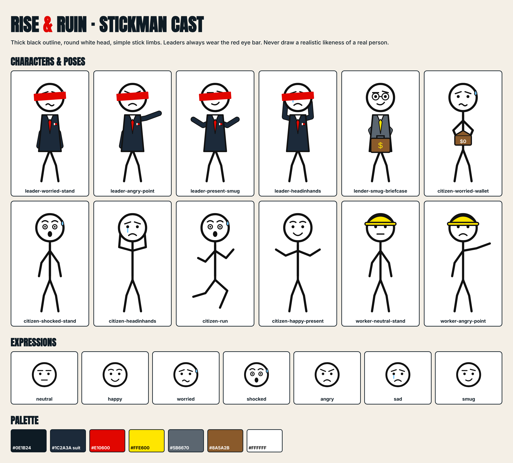

# Rise & Ruin: Stickman Cast

An **original** stickman cast designed for this channel. You own it, so there's no licensing risk. A consistent cast also strengthens the channel's originality under YouTube's inauthentic-content policy.

## Files
| Folder | What | Use it in |
|---|---|---|
| `svg/` | Vector files (scale to any size without losing quality) | Inkscape, Adobe Illustrator or Animate, Synfig, Moho, Figma |
| `png/` | Transparent PNGs (3× resolution) | CapCut, Canva, DaVinci Resolve, Kinemaster, thumbnails |
| `character-sheet.png` | The full cast on one page | Reference for you or an animator you hire |
| `character-sheet.html` | Sheet source | Re-render after changes |

## The cast
| Character | Look | Use for |
|---|---|---|
| **Leader** | Navy suit, red tie, flag pin, **red bar over the eyes** | Presidents, prime ministers, finance ministers. Every real leader is drawn this way, never as a realistic likeness |
| **Lender** | Grey suit, yellow tie, round glasses, briefcase with $ | Banks, the IMF, bondholders, foreign creditors |
| **Citizen** | Plain stickman | Ordinary people: savers, shoppers, protesters, migrants |
| **Worker** | Yellow hard hat | Factory, oil, construction and mining workers |

**Expressions:** neutral, happy, worried (sweat drop), shocked, angry, sad (tear), smug. Swap the head to change the emotion.

## Style rules (keep them consistent in every video)
1. Thick black outline, round white head, simple stick limbs.
2. Only the brand colours: navy `#1C2A3A`, red `#E10600`, yellow `#FFE600`, grey `#5B6670`, brown `#8A5A2B`.
3. Characters stand **on top of maps and charts**. The map tells the "where" and the stickman tells the "who".
4. One clear emotion per scene, matching the line being narrated.
5. Labels on characters (e.g. "IMF", "Sri Lanka") in Inter Bold when the role isn't obvious.

## Tools to animate them

**On a phone (start here if you don't have a computer)**
- **Stick Nodes:** an app made for stickman animation (Android and iOS). Good for movement such as running or pointing.
- **CapCut:** import the PNGs, then animate with keyframes (move, scale, rotate, bounce). Most faceless explainer channels animate this way: characters slide in, pop up and shake, then cut to the next scene. It's also your video editor.

**On a computer**
- **Free:** DaVinci Resolve or CapCut desktop (keyframes and editing), Synfig Studio or OpenToonz (full 2D animation), Inkscape (edit the SVGs, make new poses).
- **Paid, faster at scale:** Cartoon Animator, Moho, Adobe Animate. They let you build a character rig once and reuse it every video.

**Maps and charts**
- Maps: Natural Earth (free, public domain map data) or MapChart (check its credit requirements). For 3D relief maps in thumbnails, an AI image generator or Blender.
- Charts: Datawrapper or Flourish (free tiers, so check their terms on attribution), or make simple bar and line charts in Canva.

**Simple and realistic workflow for 2 videos a week:**
1. Record the voiceover.
2. In CapCut, lay down map and chart backgrounds for each visual cue in the script.
3. Drop the stickman PNGs on top. Use keyframes for slide-ins, pop-ups and head swaps for emotion.
4. Add captions, sound effects (whoosh, pop, cash register, alarm) and quiet background music.

## Need more poses?
Edit the SVGs in Inkscape (move the limb lines), or ask for new poses: sitting at a desk, giving a speech at a podium, signing a contract, queueing for fuel, holding a protest sign, pushing a wheelbarrow of cash. They can be generated in the same style.
